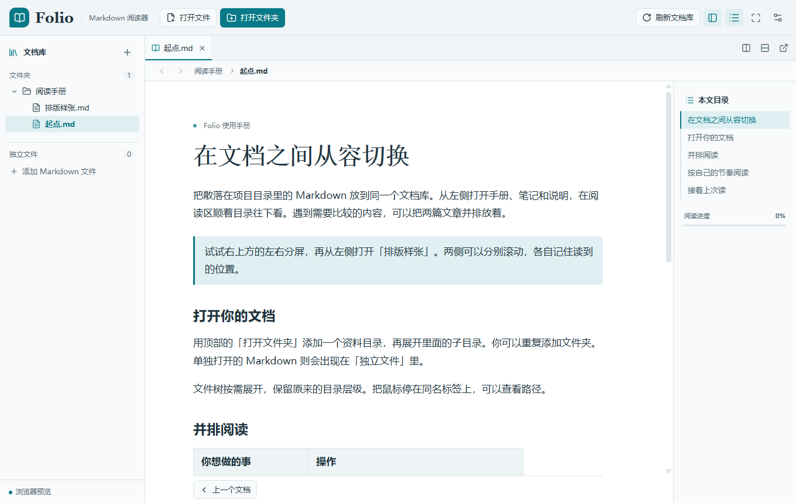

# Folio — Markdown reader for Windows and Android

A focused, read-only Markdown reader for local folders and Git repositories. Built with **Tauri 2, Vue 3, TypeScript and Rust**, with native Android file access and Git support.

[简体中文](README.zh-CN.md) · [Download](https://github.com/chenfind/folio-markdown-reader/releases) · [Report a bug](https://github.com/chenfind/folio-markdown-reader/issues)



## Start reading

Download a package from **Releases**. Windows uses the x64 installer; Android uses the ARM64 APK (Android 8 or newer). Android is an early preview: please report device-specific issues. The interface is currently in Simplified Chinese.

Open a Markdown file or folder using the toolbar. You can add several folders and individual files to the library, switch between tabs, and split the reader to compare documents. A folder becomes a reading series, with previous/next document navigation.

| Feature | Windows | Android |
| --- | --- | --- |
| Multiple folders, file tree, tabs and Markdown links | Yes | Yes, through the system document picker |
| Remember reading position and restore sessions | Yes | Yes, while file permission remains valid |
| Font size, content width, themes and eye comfort colors | Yes | Yes |
| Scrolling and single-page reading, page transitions | Yes | Yes |
| Two reading panes | Manual orientation | Top/bottom in portrait, left/right in landscape |
| Independent reading windows | Yes | Intentionally excluded |
| Public/private GitHub, GitHub Enterprise and GitLab reading | Yes | Yes |
| Optional HTTPS Git clone | Installed Git | Built-in JGit; foreground only |

Markdown rendering includes code highlighting, tables, relative document links and local images. External images are not fetched automatically. Pagination tries to preserve content blocks; long blocks can span pages. It is a reading view, not a Markdown editor or a print layout engine.


## Phone controls

The phone UI uses a bottom dock and sheets for the library, outline, appearance and tools. Open the document list from the top bar to switch or manage tabs. Sheets support the close button, system Back and dragging the heading downward.

Enable single-page reading in Appearance to swipe left/right between pages. Tap the center to hide/show reading tools. Links, text selection and scrollable tables/code retain their interactions; ordinary tables, short code and static images participate in page turning. Swipe and edge-tap paging have separate switches. Series boundaries stay in the current tab; merging splits retains both panes' documents.

See [mobile interaction rules](docs/mobile-interactions.md) and [project conventions](AGENTS.md).

## Where are my files?

**Opening a local file or folder does not copy it.** Folio reads the original location without writing to the document. Use the global refresh button after an external update; reopening the app refreshes restored documents.

On Android, select a **folder** when documents use sibling links or images. A single-file permission cannot grant access to nearby files. Moving files, clearing app data or revoking permission can require selecting the source again.

A read-only remote connection fetches repository content at a selected revision without creating a Git working copy. It requires a network connection; this mode does not promise offline caching.

**Clone is optional and never automatic.** Windows asks for a destination and uses your installed Git credentials. Android clones into app-private storage using HTTPS and a token when needed. Android cloning stops when the app leaves the foreground; failures/cancellation clean unfinished data, and retry starts a fresh shallow clone. Completed clones remain readable offline. Uninstalling Android Folio or clearing its app data removes these app-managed clones. Both online sources and local clones have settings and manual update actions, and global update handles both. Clone updates prepare a fresh shallow clone before replacing the managed copy; local edits may be overwritten. Failure or cancellation preserves the previous copy and document IDs. Ordinary local folders are only reread. Legacy Windows Git folders require explicit adoption before replacement is enabled.

## Connect a repository

Choose **远程仓库**, select GitHub or GitLab, and paste the HTTPS repository homepage. You can choose a branch/tag and a reading directory. Other HTTPS Git services are available through manual clone, without API browsing.

Public repositories usually need no token. For private repositories:

- GitHub: a fine-grained personal access token with access to the repository and **Contents: Read-only**.
- GitLab: a token with project access and **read_api** for API reading; **read_repository** is needed for HTTPS cloning.
- Enterprise servers must be reachable and use a certificate trusted by the operating system. Organization approval/SSO may be required.

Tokens are stored in Windows Credential Manager or encrypted using Android Keystore. They are not saved in document settings or repository URLs. Folio has no account service, analytics or sync backend.


[GitHub token guide](https://docs.github.com/en/authentication/keeping-your-account-and-data-secure/managing-your-personal-access-tokens) · [GitLab token guide](https://docs.gitlab.com/user/profile/personal_access_tokens/)

SSH, Git LFS object downloading, submodule recursion, background clone and in-app Git editing/push are not supported.

## Build from source

Install Node.js 22.18+ (or a newer LTS), npm and a current stable Rust toolchain. See [Tauri prerequisites](https://v2.tauri.app/start/prerequisites/) for native dependencies.

```sh
git clone https://github.com/chenfind/folio-markdown-reader.git
cd folio-markdown-reader
npm ci
npm test
npm run build
```

Browser preview: `npm run dev`. It can import local file snapshots, but does not provide native repository access or persistent folder permissions.

Windows: install Visual Studio C++ build tools, WebView2 and Git for optional cloning, then run `npm run desktop` or `npm run desktop:build`.

Android: install JDK 21, Android SDK platform 36, build-tools 36.0.0 and NDK 27.2.12479018. Set `JAVA_HOME`, `ANDROID_HOME` and `NDK_HOME` to your installations, add the Rust target, then build:

```sh
rustup target add aarch64-linux-android
npm run android:build
```

The checked-in Android Gradle project includes the native file, credential and clone adapters. Never commit local SDK paths or signing keys. Release signing is configured through environment variables; see [Android build notes](docs/android-build.md).

## Contribute

Bug reports should include app version, OS/device, reading mode and a minimal Markdown example. Remove private repository URLs and tokens from reports. Pull requests are welcome; run the frontend checks and relevant native build before submitting.

See [architecture](docs/architecture.md) and [Android requirements](docs/android-requirements.md) before changing platform behavior. In particular, Android uses in-app splits and must not enable independent windows.

Licensed under [MIT](LICENSE). Third-party libraries retain their own licenses.

## Markdown source

Open the document/tab actions menu on desktop or More on Android to view read-only Markdown source. Source defaults to pagination, with optional scrolling, search, selection and copying. Comparison mode synchronizes source lines and rendered blocks in both directions; mobile portrait stacks the panes and landscape places them side by side. Closing the viewer restores the original reading surface.
