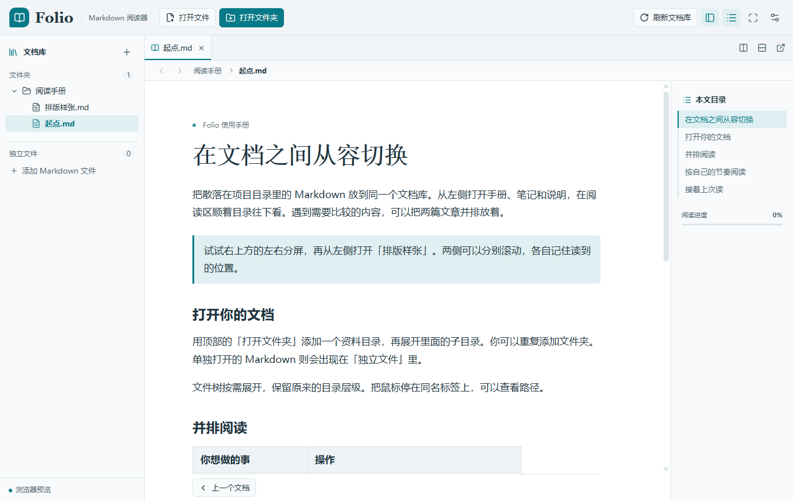

# Folio — Windows / Android Markdown 阅读器

为本地文档和 Git 仓库设计的只读 Markdown 阅读器。基于 **Tauri 2 + Vue 3 + TypeScript + Rust**，Android 使用原生文件授权和内置 Git。

[English](README.md) · [下载安装包](https://github.com/chenfind/folio-markdown-reader/releases) · [反馈问题](https://github.com/chenfind/folio-markdown-reader/issues)



## 安装与开始阅读

在 Releases 下载 Windows x64 安装包，或 Android ARM64 APK（Android 8 及以上）。Android 当前为预览版，欢迎反馈机型兼容问题；界面目前使用简体中文。

点击工具栏的打开文件或文件夹，可以重复添加多个来源。文件树、标签页和分屏方便切换与对照；文件夹会作为文档系列，支持前后文档切换。

- 调整字号、行距、正文宽度、背景色与护眼配色，保存阅读位置。
- 支持滚动阅读和单页翻页、无动画/平移/仿真翻折，系列文档之间连续翻页。
- Markdown 代码高亮、表格、相对文档链接和本地图片。
- GitHub、GitHub Enterprise、GitLab / 自建 GitLab 的公开与私有仓库，可选分支和标签。
- Windows 支持独立阅读窗口和拖拽；Android **没有独立窗口**，保留应用内双阅读区：竖屏上下分屏，横屏左右分屏，随旋转切换。

超长代码、表格或段落可能跨页，翻页模式不是精确的印刷排版。外部图片不会自动下载。

## 文件是在原处，还是复制了？

**打开本地文档是从原位置读取，不会复制或修改原文件。** 外部更新后点击全局刷新，软件重启时也会重新读取恢复的文档。

Android 使用系统文件选择器授权。文档包含相对图片或其它文档链接时，请打开整个文件夹；单文件授权不能访问旁边的文件。移动文件、撤销权限或清除应用数据后，可能需要重新选择来源。

远程“只读连接”按指定版本请求目录与正文，不创建 Git 工作副本，需要联网，不保证离线缓存。

**克隆需要手动触发，默认不克隆。** Windows 需要已安装 Git，使用 Git 自己的凭据并选择目标目录；Android 使用内置 JGit 和应用私有存储，不要求安装 Termux 或系统 Git。完成后可离线阅读。Android 切到后台会取消克隆，失败或取消后清理未完成数据，重试重新下载。卸载应用或清除数据会删除应用内克隆。

刷新按钮只重读文件，不执行 Git pull。Windows 可用外部 Git 更新克隆；Android 当前通过重新克隆获取新副本。暂不支持 SSH、LFS 文件下载、递归子模块、后台克隆及编辑/提交/推送。

## 私有仓库怎么连接？

点击“远程仓库”，选择 GitHub / GitLab，输入 HTTPS 仓库首页，可以选择分支、标签和阅读目录。其它 HTTPS Git 服务可通过手动克隆打开，不提供对应平台的 API 浏览。

公开仓库通常不用令牌。私有仓库需要：

| 平台 | 只读连接权限 | HTTPS 克隆权限 |
| --- | --- | --- |
| GitHub | Fine-grained PAT，授权目标仓库，Contents: Read-only | 同左 |
| GitLab | 有项目访问权的 read_api | read_repository |

企业仓库需要可访问的网络和系统信任的证书；组织可能要求审批或 SSO 授权。令牌保存到 Windows 凭据管理器或由 Android Keystore 加密保存，不写入普通阅读配置和仓库地址。Folio 没有账号服务、统计上报或同步后端。


[GitHub token guide](https://docs.github.com/en/authentication/keeping-your-account-and-data-secure/managing-your-personal-access-tokens) · [GitLab token guide](https://docs.gitlab.com/user/profile/personal_access_tokens/)

## 自己构建

需要 Node.js 22.18+ / 新版 LTS、npm 和新版稳定 Rust。完整原生依赖参考 [Tauri 前置环境](https://v2.tauri.app/start/prerequisites/)。

```sh
git clone https://github.com/chenfind/folio-markdown-reader.git
cd folio-markdown-reader
npm ci
npm test
npm run build
```

- 浏览器预览：`npm run dev`。浏览器导入的是文件快照，不提供原生仓库能力或持久文件夹授权。
- Windows：安装 VS C++ 构建工具和 WebView2 后运行 `npm run desktop` / `npm run desktop:build`。
- Android：安装 JDK 21、SDK platform 36、build-tools 36.0.0、NDK 27.2.12479018，设置 JAVA_HOME / ANDROID_HOME / NDK_HOME，执行 `rustup target add aarch64-linux-android` 和 `npm run android:build`。详见 [Android 构建说明](docs/android-build.md)。

## 参与项目

提交问题请注明版本、操作系统/机型、阅读模式和最小复现文档，隐藏令牌与私人仓库地址。欢迎贡献代码；提交前运行前端检查及涉及平台的原生构建。

架构边界见 [架构说明](docs/architecture.md)，Android 产品约定见 [Android 需求](docs/android-requirements.md)。修改平台逻辑时，请保留 Android 不提供独立窗口的设定。

采用 [MIT 协议](LICENSE)，第三方依赖保留各自许可证。
